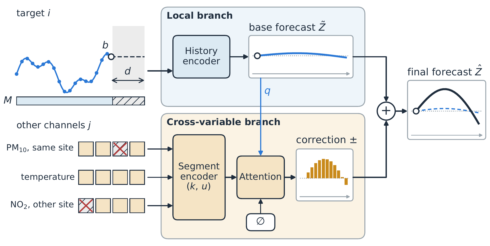

# OTARF

### Observation-gated Target-Anchored Residual Forecaster

Research code for **Multivariate time series forecasting with incomplete data: an observation-anchored model for air quality monitoring networks**.

**Loc Phan and Tham Vo** · Faculty of Information Technology, Nguyen Tat Thanh University, Vietnam

[Architecture](#architecture) · [Results](#results) · [Getting started](#getting-started) · [Reproducing the experiments](#reproducing-the-experiments) · [Evaluation protocol](#evaluation-protocol) · [Citation](#citation)

OTARF forecasts air quality when monitoring sensors stop reporting for hours or days. It combines a local forecast anchored to the latest valid observation with a signed correction drawn from observed history segments of other channels. Observation masks and ages remain explicit inputs, including when the target's entire input window is missing.

This repository provides the model, data preparation, training and evaluation code for the English v6 manuscript. Experiments cover **Beijing, London, and Shanghai**, forecast horizons of **12, 24, and 48 hours**, and comparisons with **SOFTS, TimeFilter, iTransformer, and CRIB**.

## Architecture



*Figure 2 of the English v6 manuscript. Gray regions indicate missing history; crossed-out segments are excluded from the source set. The small forecast curves are schematic.*

The forecast is decomposed as

$$
\widehat{Z}_{i,g}
= \underbrace{\widetilde{Z}_{i,g}}_{\text{anchor-based local forecast}}
+ \underbrace{\tanh(\gamma)\,W_o\!\sum_{(j,p)\in\mathcal{S}_i}\alpha_{i,g,j,p}\,u_{j,p}}_{\text{signed cross-variable correction}}.
$$

- **Anchor-relative history.** Each channel is represented by observed departures from its latest valid observation: $R_{s,j}=M_{s,j}(Z_{s,j}-b_j)$. The anchor may precede the 96-hour input window. Masks distinguish missing hours from observations equal to the anchor; ages enter as $\log(1+d)$.
- **Local branch.** A shared encoder uses the target's relative history, observation status, anchor, calendar features, and channel identity to produce the base forecast.
- **Cross-variable branch.** Other channels are divided into 24-hour segments. A query derived from the local forecast and target observation status attends only to segments containing measurements, together with a null source. Queries are formed for groups of 12 forecast hours.
- **Fallback.** If no valid source segments remain, the correction is exactly zero and the output equals the local forecast.

OTARF uses training-set standardization without per-window normalization. The paper examines why window normalization attenuates forecast variation when an imputed input window is constant, and tests that mechanism by retraining the comparison models with window normalization disabled.

## Results

The following values are **test nMAE at a 24-hour forecast horizon**, averaged over three seeds, from Tables 3 and 4 of the English v6 manuscript. Lower is better; bold marks the lowest error among the five models.

| Network | Input history | OTARF | SOFTS | TimeFilter | iTransformer | CRIB |
|---|---|---:|---:|---:|---:|---:|
| Beijing | Natural | **0.426** | 0.445 | 0.430 | 0.449 | 0.443 |
| London | Natural | **0.597** | 0.627 | 0.622 | 0.625 | 0.610 |
| Shanghai | Natural | **0.636** | 0.686 | 0.668 | 0.685 | 0.662 |
| Beijing | Latest 96 h of one target masked | **0.547** | 0.837 | 0.837 | 0.837 | 0.736 |
| London | Latest 96 h of one target masked | **0.708** | 1.018 | 1.018 | 1.018 | 0.767 |
| Shanghai | Latest 96 h of one target masked | **0.760** | 1.144 | 1.144 | 1.144 | 0.880 |

Natural-history scores include all evaluable targets; masking scores include only the masked target's labels. These are different label sets, so differences between the two rows of a network are not paired estimates of degradation. Bold values indicate point estimates, not statistical significance.

Across all three horizons, OTARF has the lowest natural-history error in eight of nine network–horizon pairs and meets the paper's non-inferiority criterion. It meets the superiority criterion under both 24- and 96-hour single-target masking. At the 24-hour horizon, it also has lower error in 46 of 48 comparisons against models with window normalization disabled; no comparison significantly favors those models.

The findings have limits: the advantage narrows at longer horizons, most outage evidence comes from controlled masking, and attention does not meet the component-contribution criterion against uniform averaging. **OTARF-peak** improves high-concentration errors in most settings at a cost to routine forecasting; it remains a separate configuration rather than the default.

## Getting started

### Environment

Use **Python 3.10**, **PyTorch 2.3.1**, and a CUDA GPU. The manuscript experiments used RTX 2080 Ti GPUs. Dependencies are pinned in [requirements.txt](requirements.txt).

```bash
git clone https://github.com/phananhlocpal/otarf.git
cd otarf
python3.10 -m venv .venv
source .venv/bin/activate
pip install -r requirements.txt
```

Data preparation also needs `curl`, `unzip`, and `shasum`. Shanghai is distributed inside a RAR archive; install one of `unrar`, `unar`, or `7z` before downloading. Baseline setup requires Git.

At the 24-hour horizon, OTARF's measured peak allocated GPU memory is below 200 MiB. Comparison models require more memory: the Beijing runs use about 8.4 GB for TimeFilter and 13.3 GiB for CRIB. These are model allocation measurements, not total GPU capacity requirements.

### Data

```bash
bash scripts/download_data.sh
python scripts/prepare_data.py
```

| Network | Dataset identifier | Hours | Input channels | Pollutant targets | Evaluable test targets |
|---|---|---:|---:|---:|---:|
| Beijing | `beijing_multisite` | 35,064 | 156 | 72 | 72 |
| London | `kdd2018_london` | 10,920 | 59 | 59 | 52 |
| Shanghai | `shanghai_confirmation` | 52,584 | 15 | 3 | 3 |

Sources: [Beijing Multi-Site, UCI 501](https://archive.ics.uci.edu/dataset/501/beijing+multi+site+air+quality+data), [KDD Cup 2018 with missing values, Monash deposit](https://doi.org/10.5281/zenodo.4656719), and the Shanghai subset of [PM2.5 Data of Five Chinese Cities, UCI 394](https://archive.ics.uci.edu/dataset/394/pm2+5+data+of+five+chinese+cities).

Preparation writes `data/processed/<dataset>/data.csv`, `observations.npz`, and `metadata.json`. The CSV contains causally forward-filled inputs; the NPZ preserves original measurements and observation masks for observed-label losses and metrics. Leading gaps use training-set medians. Channels are retained using training coverage of at least 20% and nonzero training variance.

<details>
<summary>Processed-data SHA-256 checksums</summary>

| File under `data/processed/` | SHA-256 |
|---|---|
| `beijing_multisite/data.csv` | `0bd9ec2540fc95d28613ca6da7ce1c00c538fc42abe116f71c169ba22023afb8` |
| `beijing_multisite/observations.npz` | `6df743f66412610d200751e31008207faed8f8829bd88b94d7534de77288dad5` |
| `kdd2018_london/data.csv` | `4d9c5b37a9cb9df3f0c62710349577d4d81bad4a4ad156a65a6bc8c0bf1c239d` |
| `kdd2018_london/observations.npz` | `07312b9749c4534102e879653fef2ea9f8668fd22f81f18eae142405a9c06f72` |
| `shanghai_confirmation/data.csv` | `e54c5dbf99d77a74d8e529268516dceaa4d774028d8503e7dd75a536a49343b7` |
| `shanghai_confirmation/observations.npz` | `1fa3ec9b791f446e17ec4d685dceea67b1b58a5992f3c7ff197aece513a47d0a` |

</details>

### Train and evaluate OTARF

Run commands from the repository root:

```bash
python scripts/train_otarf.py --dataset beijing_multisite --horizon 24 --seed 2021
```

Each run trains for 10 epochs, selects the checkpoint with the lowest validation nMAE on natural histories, evaluates best and last checkpoints on validation and test, and evaluates single-target masking of 6, 24, and 96 hours.

Artifacts are written to `runs/OTARF-otarf/beijing_multisite/h24/s2021/`, including run metadata, learning curves, checkpoints, `result.json`, natural-history metrics and per-origin errors in `best/` and `last/`, and controlled-masking outputs in `masked/`.

## Reproducing the experiments

### Comparison models

Fetch the official implementations at the locked commits:

```bash
bash scripts/fetch_baselines.sh
```

The lock file [configs/baselines.lock.json](configs/baselines.lock.json) records commits and Python-file hashes, which are checked before training. The primary comparisons use official model implementations with the paper's common training recipe, rather than each model's original training pipeline.

| Models | Observation information | Training entry point |
|---|---|---|
| SOFTS, TimeFilter | Forward-filled values, mask and log-age as extra variates | `train_baseline.py --recipe indicator` |
| iTransformer | Forward-filled values, mask and log-age as extra variates | `train_extended_baseline.py` |
| CRIB | Authors' mask-multiplied, zero-filled input; no age variates | `train_extended_baseline.py` |

All four use observed-label MAE plus the auxiliary imputed-channel MSE, masking augmentation, and validation-nMAE checkpoint selection. They retain their configured architecture, learning rate, and batch size; TimeFilter and CRIB additionally retain their official auxiliary losses. CRIB uses the study's 96-hour input window instead of the authors' 24-hour window. Calendar-feature inputs differ as documented in manuscript Table 2.

```bash
python scripts/train_baseline.py --model TimeFilter --recipe indicator --dataset kdd2018_london --horizon 24 --seed 2021
python scripts/train_extended_baseline.py --model iTransformer --dataset beijing_multisite --horizon 24 --seed 2021
python scripts/train_extended_baseline.py --model CRIB --dataset kdd2018_london --horizon 24 --seed 2021

# Mechanism test: retrain with window normalization disabled (H = 24).
python scripts/train_extended_baseline.py --model TimeFilter --dataset kdd2018_london --horizon 24 --seed 2021 --no-window-norm
```

The normalization intervention uses the official `use_norm=0` flag for SOFTS and iTransformer and replaces the normalization module with an identity for TimeFilter and CRIB; see [otarf/nonorm.py](otarf/nonorm.py). This intervention is separate from the primary comparisons. One CRIB run without normalization (Beijing, seed 2022) diverged at epoch 6; its reported results use two seeds.

Optional original-trainer runs for SOFTS and TimeFilter use `--recipe official` and are not the comparisons reported in the manuscript.

### Ablations and peak-weighted training

```bash
python scripts/train_otarf.py --dataset beijing_multisite --horizon 24 --seed 2021 --variant no_cross
python scripts/train_otarf.py --dataset beijing_multisite --horizon 24 --seed 2021 --peak
```

| `--variant` | Change from full OTARF |
|---|---|
| `otarf` | Full model; default |
| `no_cross` | Remove the cross-variable correction |
| `no_anchor` | Use filled standardized history; remove the anchor from the forecast baseline and features |
| `state_blind` | Replace masks, ages, and anchor validity with constants, including in source selection |
| `state_blind_no_aug` | Remove observation status and masked-history augmentation |
| `mean_pool` | Replace attention with uniform averaging over the same valid sources |

Ablations use H = 24 and all three seeds; component decisions use validation results. `--peak` uses the full architecture and triples the forecasting-error weight for observed labels at or above each target's training-set 95th percentile.

### Experiment orchestration

The study uses datasets listed above, horizons `12 24 48`, and seeds `2021 2022 2023`.

```bash
# All training and inference sections, followed by summaries and available figure exports.
bash scripts/reproduce_all.sh

# Select sections; the script still attempts the summary and figure-export stage.
bash scripts/reproduce_all.sh otarf baselines ablation
```

| Section | Scope |
|---|---|
| `otarf` | Full OTARF, all horizons |
| `baselines` | SOFTS and TimeFilter with observation indicators, all horizons |
| `ablation` | Five OTARF variants, H = 24 |
| `inspect` | Source attention, source knockout, and case-study inference |
| `extended` | iTransformer, CRIB, and OTARF-peak, all horizons |
| `outages` | Multiple-target/station masking, naive references, and hourly-event diagnostics |
| `nonorm` | Four comparison models without window normalization, H = 24 |
| `events24` | Events based on 24-hour means, H = 24 |
| `official` | Optional original-trainer runs; excluded from the default command |

The launcher skips training directories containing `result.json`. It does not resume optimizer state or verify that an existing result matches a changed configuration; use a fresh run directory when changing settings. Inference sections need the corresponding trained checkpoints. Partial runs may produce partial summaries or leave figure exports without their required inputs.

### Analysis outputs and manuscript mapping

After the required training and inference runs are available:

```bash
python scripts/summarize.py
python scripts/summarize_extensions.py
python scripts/summarize_v6.py
python scripts/make_figures.py
```

Paths below are relative to `results/`. The `v6/` outputs contain the final five-model comparisons; the top-level summary tables also support earlier comparisons and component analyses.

| English v6 manuscript | Output or source |
|---|---|
| Tables 3–4: natural histories and single-target masking, all horizons | `v6/all_horizons.csv`, `v6/all_horizons_bootstrap.csv`, `v6/all_horizons_decision.json` |
| Table 5: normalization intervention and PM2.5 error in concentration units | `v6/nonorm_vs_otarf.csv`, `v6/pm25_ugm3.csv` |
| Table 6: real trailing outages | `extensions/E1_real_gaps.csv` |
| Table 7: component contributions | `table_ablation_paper.csv`; validation decisions in `decisions.json` |
| Table 8: source-group knockout | `table_sources.csv`, after `inspect_otarf.py` |
| Table 9: high-concentration, rapid-increase, and stable labels | `v6/label_groups.csv` |
| Table 10: parameters and computational cost | `table_cost_h24.csv` |
| Figure 1: outage lengths | `figures/gap_lengths.pdf` and `.png` |
| Figure 2: architecture | README preview: `assets/otarf_overview.png` (repository-root path) |
| Figure 3: 96-hour case study | `figures/case_96h.pdf` and `.png`, after `inspect_otarf.py` |
| Figure 4: simultaneous outages | Plotting data: `extensions/B_multi_outage.csv` |
| Figure 5: 24-hour-mean event F1 | Plotting data: `v6/events24.csv` |

`make_figures.py` exports gap lengths, masking curves, and the case study. The architecture preview above is rendered directly from the English v6 manuscript PDF; `draw_overview.py` exports the earlier Vietnamese-label schematic. The included scripts produce the numerical data for Figures 4 and 5; their final manuscript layouts are not exported by `make_figures.py`.

## Evaluation protocol

- **Temporal split:** chronological 70/10/20% train/validation/test; 96-hour histories; no forecast targets cross split boundaries. Normalization uses training statistics only, and future meteorological observations are excluded.
- **Training:** 10 epochs; natural and masked history copies per batch. Each channel in the masked copy is selected with probability 0.25 for a trailing 24- or 96-hour interruption. Values, masks, ages, and anchors are reconstructed consistently. OTARF adds a squared-correction penalty of $10^{-4}$.
- **Primary metric:** nMAE is observed-label MAE divided by each target's training standard deviation, averaged equally over targets with labels in the scored split. Older output fields call this `sMAE`.
- **Controlled single-target masking:** a fixed SHA-256 rule selects one target per origin. Its last 6, 24, or 96 hours are replaced with the last valid pre-gap value, and only that target's observed future labels are scored. Persistence uses the same pre-gap value and labels.
- **Simultaneous masking:** at H = 24, interrupt 25% or 50% of targets, or all channels at 25% or 50% of stations, for 24 or 96 hours. Station scenarios apply to Beijing and London; Shanghai has only target-wise scenarios.
- **Uncertainty:** paired moving-block bootstrap on seed-averaged per-origin errors, block lengths H and 168 hours, and 20,000 resamples. Bonferroni families contain 36 comparisons per primary scenario, 12 per normalization-intervention scenario, and 15 for ablations. Significance requires an interval excluding zero at both block lengths. This estimates temporal uncertainty, separately from training-seed variation.
- **Primary decision rule:** superiority requires all 36 comparisons to favor OTARF, with at least 28 significant. Non-inferiority requires no comparison to be worse by more than 1%. Component and peak-variant decisions use validation data under the manuscript's specified criteria.

For Figure 5, PM2.5 events use the mean over the next 24 forecast hours. At least 20 observed hours are required in Beijing and Shanghai, or 18 in London. The historical-data thresholds are 75 µg/m³ in Beijing and Shanghai (GB 3095-2012) and 36 µg/m³ in London (the lower boundary of the UK DAQI Moderate band). The separate hourly-event diagnostics in `extensions/E4_events.csv` are not the daily-mean analysis in Figure 5.

Seeds, deterministic cuDNN settings, and `torch.use_deterministic_algorithms(True, warn_only=True)` are set for each run. TimeFilter uses a CUDA operation without a deterministic kernel; exact numerical agreement across executions and GPU models is not guaranteed.

## Repository structure

```text
assets/                 Architecture preview from the English manuscript
configs/                Model settings, baseline source locks, fixed case selection
otarf/
  core.py               OTARF architecture and component switches
  data.py               Chronological windows, observation status, and anchors
  augmentation.py       Masked-history training views
  training.py           Shared training recipe and checkpoint selection
  baselines.py          Wrappers for official comparison models
  nonorm.py             Window-normalization intervention
  evaluate.py           Shared observed-label evaluator
  masking.py            Controlled single-target masking
  outages.py            Simultaneous outages and naive references
  events.py             Events on 24-hour means
  inspect.py            Source attention and knockout inference
  statistics.py         Paired temporal block bootstrap
scripts/                Data, training, evaluation, and analysis entry points
requirements.txt        Pinned Python dependencies
```

Downloaded datasets (`data/`), baseline clones (`external/`), trained artifacts (`runs/`), and generated analyses (`results/`) are created locally and excluded from version control.

## Citation

If you use this code, please cite the accompanying manuscript. The entry below describes the manuscript; publication metadata should be added when available.

```bibtex
@unpublished{phan_otarf_2026,
  title  = {Multivariate time series forecasting with incomplete data:
            an observation-anchored model for air quality monitoring networks},
  author = {Phan, Loc and Vo, Tham},
  year   = {2026},
  note   = {Manuscript},
  url    = {https://github.com/phananhlocpal/otarf}
}
```

## Data and third-party licences

Beijing Multi-Site and PM2.5 Data of Five Chinese Cities are distributed under CC BY 4.0 by UCI. For KDD Cup 2018, consult the Monash deposit and original competition terms. Baseline implementations retain their upstream licences; see the repositories recorded in [configs/baselines.lock.json](configs/baselines.lock.json).
